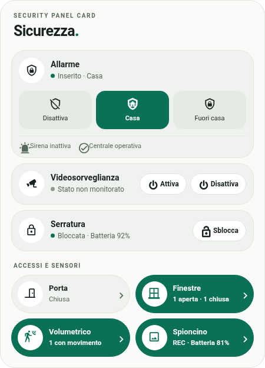
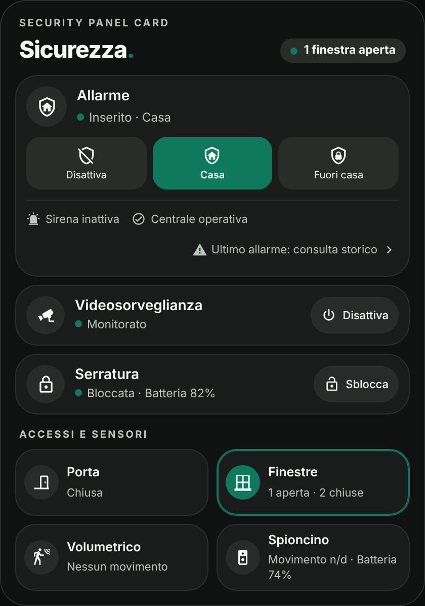
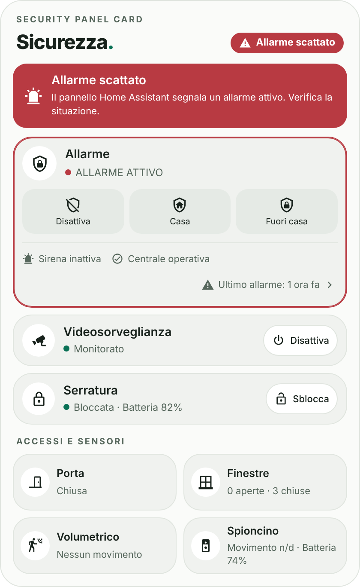
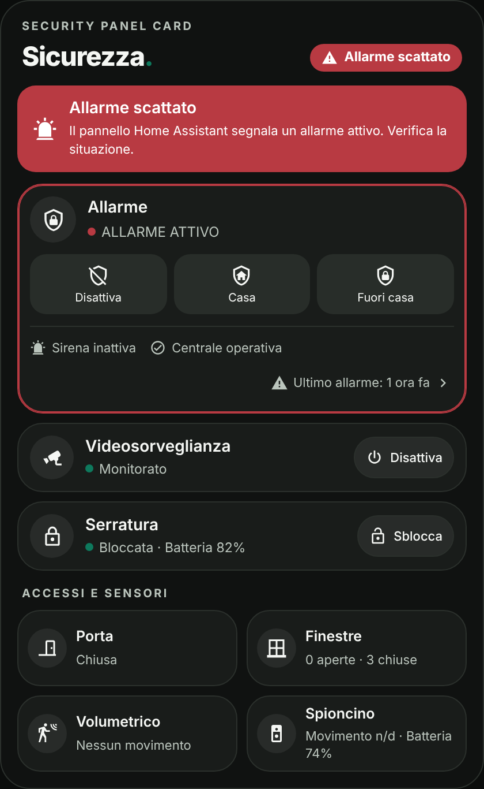
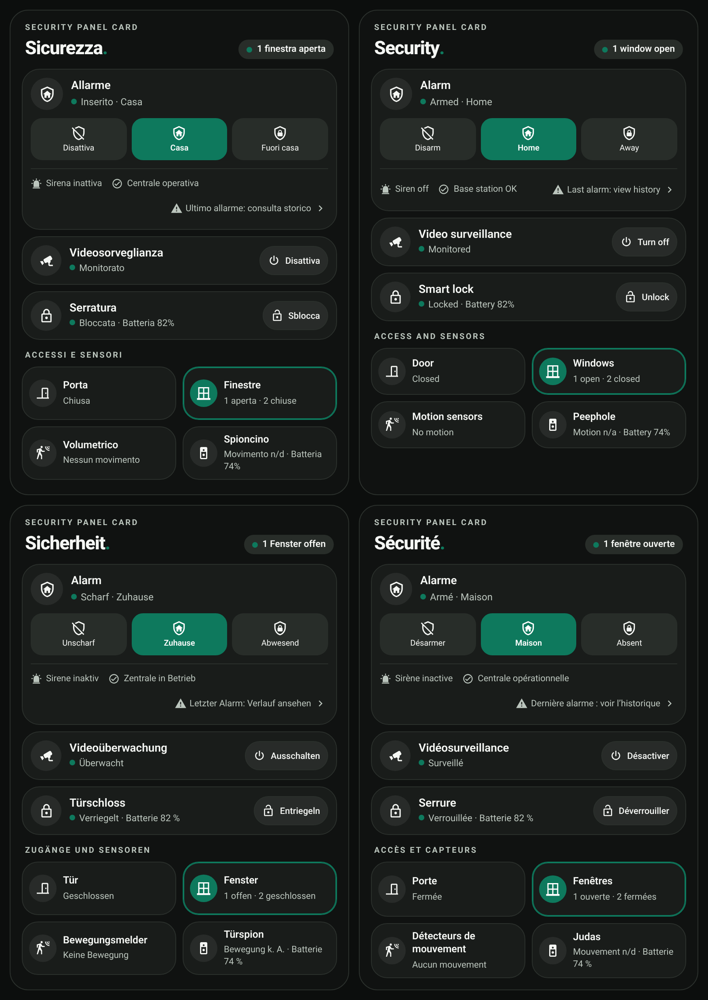

# Security Panel Card

## Overview

**Security Panel Card** is a custom security dashboard card for Home Assistant, designed with a minimalist, responsive interface inspired by the Edera Light and Dark visual styles.

It brings together alarm controls, video surveillance, smart locks, doors, windows, motion sensors, and digital peephole information in a single dashboard card.

The card is modular: video surveillance, smart lock, door, windows, motion sensors and digital peephole can each be turned on or off and placed in the order you prefer. It is available in Italian, English, German and French.

The card uses entities and services already configured in Home Assistant. It is not tied to a specific device manufacturer and does not require a dedicated account, paid API, or subscription.

## Preview

  
  

  
  

  

*Security Panel Card in Edera Light and Dark modes, in normal operation and with a triggered alarm, and in its four languages (Italian, English, German and French). The previews use demonstration values and do not display private installation data.*

## Features

- **Alarm control:** Arm Home or Away, disarm, display the current alarm state, and request an alarm code when required by the integration.
- **Alarm history:** View the most recent confirmed triggered event found in the available Home Assistant history, including its date and time.
- **Siren status:** Monitor an optional siren entity. Separate manual siren control can be enabled for a supported `siren.*` or `switch.*` entity, with confirmation before activation.
- **Control panel status:** Display an optional status entity for the security system.
- **Video surveillance:** Run separate Home Assistant scripts to enable or disable cameras or an NVR. Without a status entity, the card shows "State not detected" and keeps both buttons available; with an optional status entity, it shows the current state and the relevant button.
- **Smart lock:** Display lock status, optional battery information, and lock/unlock controls with optional confirmation or visual PIN.
- **Doors and windows:** Monitor opening states, count open and closed windows, and inspect individual sensors.
- **Motion sensors:** Display movement detected by configured sensors without automatically executing commands.
- **Digital peephole:** Show the latest image from an `image.*` entity, optional battery level, recording status, and available movement information.
- **Summary at a glance:** A header indicator reports triggered alarms, unavailable data, open doors or windows, or that everything is closed.
- **Modules:** The alarm panel, video surveillance, smart lock, door, windows, motion sensors and digital peephole are independent. Turn each one on or off and reorder them with the arrows in the editor. A card can use a single module.
- **Code keypad:** The alarm code and the optional lock PIN are typed on a numeric keypad. Alarm codes in text format use a password field. A code is typed every time and is never stored in the card or in its settings.
- **Languages:** Italian, English, German and French. The language follows the Home Assistant user, or you can choose one in the editor. When the card language is the language of the Home Assistant user, entity states are taken from the Home Assistant translations when available. Every other text is shown in English if the language is not one of the four.
- **Header:** The top label and the title can be edited or hidden independently.
- **Edera appearance:** Automatic, Light, and Dark themes, a compact layout that adapts to the card width, rounded elements, and native Home Assistant icons.
- **Visual configuration:** Choose entities with the native Home Assistant selectors in the dashboard editor.

Alarm-triggered warnings are shown in red only when the alarm panel reports `triggered`. Active door, window, and motion sensor states highlight the sensor icon in the Edera green.

Missing or unavailable entity information is not treated as a confirmed safe state, and the header summary reports it as unavailable data.

## Installation

### Marketplace (Recommended)

Install Security Panel Card directly from the default Marketplace catalog in Home Assistant 2026.11 or newer.

1. Go to **Settings** > **Marketplace**.
2. The first time, accept the notice about community content.
3. Use **Search** to find **Security Panel Card**.
4. Open the repository page and select **Install**.
5. Check the version in the dialog and select **Install** again to confirm.
6. Reload your browser to load the new resource.
7. Add **Security Panel Card** to your dashboard and configure it using the visual editor.

### Manual installation

1. Download `dist/security-panel-card.js` from this repository.
2. Copy the JavaScript file to the `www` directory of your Home Assistant configuration.
3. In Home Assistant, open **Settings → Dashboards → Resources**.
4. Add `/local/security-panel-card.js` as a **JavaScript module**.
5. Reload the dashboard and add the custom card.

If the `www` directory was newly created, Home Assistant may require a restart before the file is accessible.

## Configuration and Usage

### Visual editor

Open a dashboard in edit mode, add **Security Panel Card**, and configure the available sections:

- **Alarm:** The alarm panel entity, whether to show the panel, the real commands, the alarm code options, the optional siren (with separate manual control) and control panel status.
- **Modules:** Video surveillance, smart lock, door, windows, motion sensors and digital peephole. For each module: whether it is shown, its entities, an optional name and its position.
- **Appearance:** Top label, title, a switch for each of them, theme, language, event highlighting and attention animations.

The editor uses native Home Assistant entity selectors, with multiple selection for windows and motion sensors.

### Enabling real commands

**Security Panel Card operates in read-only mode by default.**

To enable supported controls:

1. Open the dashboard editor and select Security Panel Card.
2. In **Alarm**, turn on **Enable real commands**.
3. Verify the selected entities before using any command.

These settings do not grant additional Home Assistant permissions.

Manual siren control must also be enabled separately in **Alarm** with **Allow manual siren control**, with a supported controllable entity selected. Activating the siren requires explicit confirmation.

### Optional visual lock PIN

The lock PIN is an optional browser-side confirmation feature.

When enabled, a salted PBKDF2-SHA256 derived value is stored instead of the plaintext PIN. Secure browser cryptographic functionality is required.

**Important:** The visual PIN is not an authentication system and must not be relied upon for physical access security. Users already authorized to control the lock through Home Assistant may use other interfaces or services.

## Compatibility and Requirements

Security Panel Card requires:

- Home Assistant with support for custom JavaScript dashboard cards.
- Compatible Home Assistant entities for the functions being configured.

Supported entity domains include `alarm_control_panel`, `script`, `lock`, `siren`, `switch`, `image`, `binary_sensor`, and `sensor`, along with other compatible entities supported by individual settings.

Optional historical information requires accessible Home Assistant history/Recorder data. Historical results depend on retention settings, entity exclusions, and available records.

No specific minimum Home Assistant version has been independently verified for this repository.

The card does not require a dedicated paid service or additional remote JavaScript libraries.

## Privacy and Security

Security Panel Card operates through Home Assistant entities, services, and the permissions of the authenticated user.

- Real commands are disabled by default.
- Alarm codes are requested when needed and are not stored in the card configuration.
- No Home Assistant administrator password is requested by the card.
- The optional lock PIN provides only local interface confirmation.
- The card does not include advertising, analytics, telemetry, or user-tracking services.
- Camera and sensor information is obtained through Home Assistant.
- Device integrations may independently communicate with their manufacturers' cloud services.

**Security Panel Card is not a certified intrusion detection or access control system.** Its security depends on Home Assistant permissions, configured integrations, and the connected devices.

Unknown, unavailable, or missing information must not be interpreted as confirmation that a property or device is secure.

## Releases

Published versions are available through [GitHub Releases](https://github.com/luigi-regolo/security-panel-card/releases).

## Copyright & License

Copyright © 2026 luigi-regolo.

Original project created and maintained by **luigi-regolo**.

Licensed under the **GNU General Public License version 3 only (GPL-3.0-only)**.

See the [LICENSE](LICENSE) file for the complete license terms.

The software is provided without warranty to the extent permitted by applicable law.
