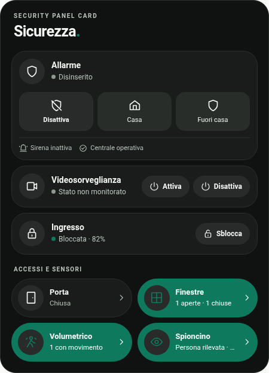
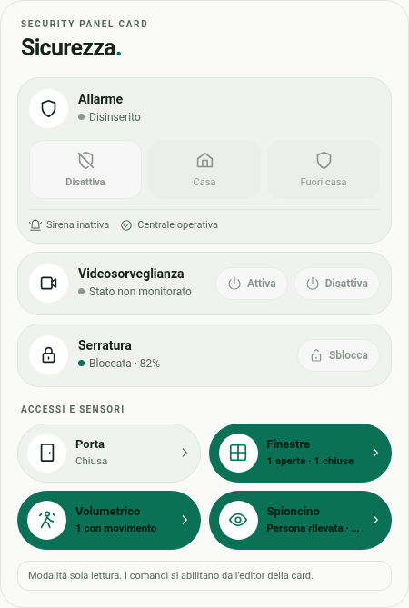

# Security Panel Card

**Un pannello di sicurezza moderno per Home Assistant**, che riunisce allarme, videosorveglianza, serratura intelligente, porte, finestre, sensori di movimento e spioncino digitale in un'unica scheda.

Security Panel Card è una custom card per le dashboard Home Assistant, progettata con un'interfaccia minimal, controlli intuitivi e una grafica adattiva ispirata ai temi Edera Light e Dark.

La card è indipendente dai produttori: utilizza le entità e gli script già configurati in Home Assistant.

> **Stato del progetto:** versione di sviluppo. Il funzionamento con entità reali e l'editor nativo devono ancora essere verificati in Home Assistant. La modalità di controllo dei dispositivi è inizialmente disattivata.

## Anteprime

| Tema Dark | Tema Light |
| :---: | :---: |
|  |  |

Le anteprime utilizzano entità dimostrative e non contengono informazioni di installazioni personali.

## Funzionalità

### Allarme

- Inserimento in modalità Casa o Fuori casa, se supportato dall'entità `alarm_control_panel`.
- Disinserimento tramite pannello di controllo.
- Richiesta del codice allarme, quando necessaria.
- Visualizzazione dello stato della sirena.
- Monitoraggio dello stato della centrale, se disponibile.

### Videosorveglianza

- Attivazione tramite script Home Assistant.
- Disattivazione tramite script indipendente.
- Visualizzazione facoltativa dello stato effettivo dell'NVR.

Se non viene configurato un sensore di stato, la card mostra entrambi i comandi senza presumere che il registratore sia acceso o spento. Un comando inviato non equivale alla conferma del suo completamento.

### Serratura intelligente

- Visualizzazione dello stato bloccata/sbloccata.
- Comandi di blocco e sblocco.
- Percentuale batteria, quando disponibile.
- Sblocco diretto con conferma facoltativa.
- Tastierino PIN visuale opzionale.
- Richiesta del PIN corrente nell'editor per modificarlo o disattivarlo.

**Importante:** il PIN visuale è una conferma nel browser, non un sistema di autenticazione o controllo accessi. Un utente già autorizzato a usare i servizi Home Assistant può aggirarlo utilizzando altre interfacce. Non affidarsi a questa funzione per proteggere fisicamente una porta.

### Porte e finestre

- Stato aperto o chiuso della porta.
- Conteggio delle finestre aperte e chiuse.
- Apertura dei dettagli delle singole entità.
- Evidenziazione degli stati attivi con il verde Edera.
- Segnalazione dei sensori non disponibili, senza considerarli chiusi.

### Sensori di movimento

- Monitoraggio di uno o più sensori volumetrici.
- Indicazione del movimento rilevato.
- Elenco dei sensori configurati.
- Funzionamento esclusivamente in lettura.

### Spioncino digitale

- Collegamento a un'entità videocamera.
- Apertura dei dettagli video di Home Assistant.
- Percentuale della batteria, se disponibile.
- Stato registrazione, se esposto dall'integrazione.
- Indicazione del movimento davanti alla porta.
- Indicazione del rilevamento persone, quando supportato.
- Visualizzazione facoltativa dell'ultimo evento.
- Nome personalizzabile dell'area monitorata.

Il rilevamento di una persona richiede un'entità dedicata. Un semplice sensore di movimento non consente di identificare automaticamente una presenza umana. Gli stati di movimento in corso e ultimo evento sono distinti.

## Design Edera

Security Panel Card offre tre modalità: **Auto** (segue Home Assistant), **Light** (fondo chiaro e riquadri grigio-verde), **Dark** (fondo quasi nero e riquadri antracite).

Gli elementi utilizzano bordi arrotondati, icone compatte e tipografia coerente con Home Assistant. Gli stati attivi possono essere evidenziati con un verde Edera pieno. Le condizioni critiche, come un allarme scattato, mantengono una segnalazione distinta. Le animazioni sono facoltative e rispettano le preferenze di movimento ridotto del dispositivo.

## Configurazione visuale

La card dispone di un editor grafico organizzato in sei sezioni:

| Sezione | Configurazione |
| --- | --- |
| Allarme | Pannello, sirena, centrale e richiesta codice |
| Videosorveglianza | Script attivazione, script disattivazione e stato NVR |
| Serratura | Entità `lock`, batteria e conferma PIN |
| Sensori | Porta, finestre, volumetrico e spioncino |
| Aspetto | Titolo, tema ed evidenziazione degli stati |
| Avanzate | Abilitazione comandi e animazioni |

Le entità vengono selezionate dall'installazione Home Assistant tramite l'editor visuale, senza configurazione YAML obbligatoria. Le funzionalità aggiuntive sono facoltative: ogni utente può mostrare soltanto gli elementi desiderati.

## Installazione tramite HACS

Security Panel Card si installa tramite HACS, aggiungendo il repository come archivio personalizzato. Non è necessario copiare manualmente il JavaScript in Home Assistant.

Il pulsante apre la procedura in Home Assistant attraverso My Home Assistant. L'aggiunta dell'archivio e l'installazione richiedono comunque la conferma dell'utente; il pulsante non significa che la card sia presente nel catalogo predefinito HACS.

1. Aprire HACS in Home Assistant.
2. Selezionare il menu **⋮ → Archivi personalizzati**.
3. Inserire il repository: `https://github.com/luigi-regolo/security-panel-card`.
4. Selezionare la categoria **Dashboard**.
5. Aggiungere l'archivio e installare Security Panel Card.
6. Ricaricare la pagina di Home Assistant.
7. Aggiungere Security Panel Card alla dashboard e configurare le entità dall'editor grafico.

Se la risorsa non viene registrata automaticamente, verificare nelle risorse della dashboard che sia presente il modulo `/hacsfiles/security-panel-card/security-panel-card.js`.

Queste istruzioni verranno validate in una prova di installazione dopo la pubblicazione. Il repository personalizzato HACS non implica l'inclusione nel catalogo ufficiale HACS.

## Sicurezza e privacy

Security Panel Card utilizza le entità, le autorizzazioni e i servizi disponibili in Home Assistant.

- I comandi reali sono disabilitati per impostazione predefinita.
- Nessuna password amministratore Home Assistant viene richiesta o memorizzata dalla card.
- Il codice dell'allarme viene inserito al momento dell'utilizzo e inviato all'integrazione, senza salvarlo nella configurazione.
- Il PIN visuale della serratura non viene salvato in chiaro: viene conservato un valore derivato con salt, ma la verifica resta locale al browser ed è aggirabile da utenti Home Assistant già autorizzati.
- Non sono presenti telemetria, pubblicità, servizi di analisi o dipendenze JavaScript remote nella card.
- I dispositivi e le loro integrazioni possono utilizzare servizi cloud indipendenti dalla card.

**Security Panel Card non è un sistema antintrusione certificato.** La sicurezza effettiva dipende dalle autorizzazioni Home Assistant, dal pannello allarme e dai dispositivi integrati. Il codice sorgente è fornito senza garanzie aggiuntive rispetto a quanto previsto dalla licenza.

## Compatibilità

La card utilizza domini Home Assistant standard, tra cui `alarm_control_panel`, `script`, `lock`, `camera`, `binary_sensor`, `sensor`, e le entità compatibili effettivamente disponibili nella tua istanza. Nessun produttore è obbligatorio. Alcuni stati potrebbero non essere esposti dall'integrazione usata.

## Segnalazioni e contributi

Problemi e suggerimenti possono essere condivisi tramite la sezione Issues del repository GitHub.

Prima di pubblicare screenshot, log o configurazioni, rimuovere credenziali, PIN, token, identificativi personali, indirizzi e altri dati privati.

## Licenza

**GNU GPL-3.0-only.** Vedere il file [LICENSE](LICENSE).
